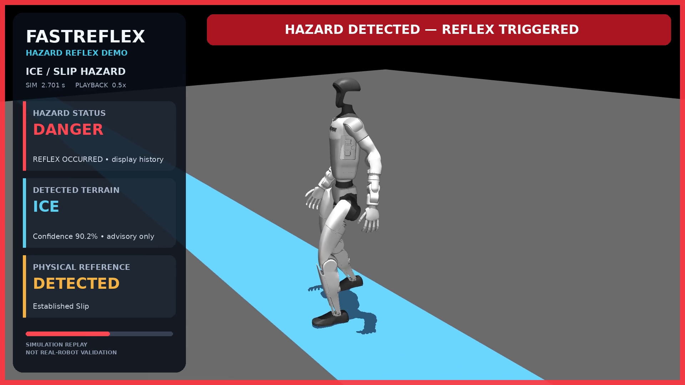
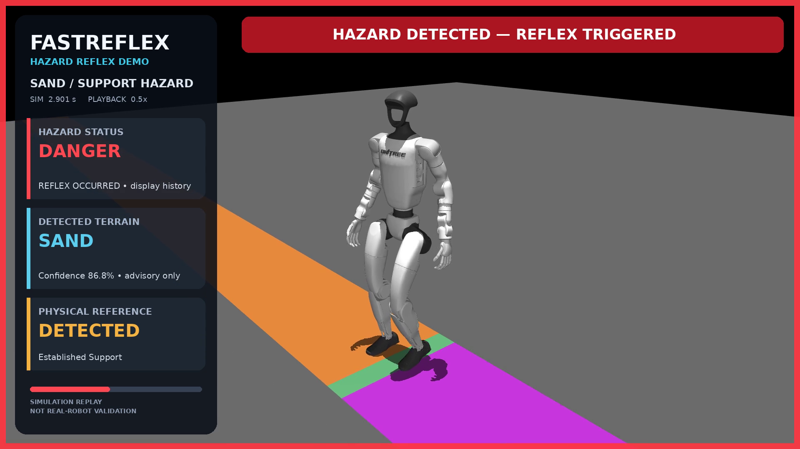
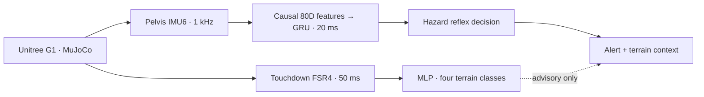

# FastReflex · Humanoid Hazard Detection Research

**Unitree G1의 보행 중 미끄러짐과 지지면 변형을 감지하고, 지형 정보를 함께 제공하는 연구 프로젝트입니다.**

MuJoCo에서 센서 데이터를 생성하고, IMU 기반 위험 감지 모델과 발바닥 압력 기반 지형 분류 모델을 학습·평가합니다. 핵심 질문은 제한된 센서로 위험을 구분할 수 있는지, 그리고 그 판단이 새로운 물리 조건에서도 유효한지입니다. 검토·동결한 engineering reference 모델의 변환과 실보드 실행은 [FastReflex E84](https://github.com/shinjuyeop/Infineon_FastReflex_E84)에서 검증합니다.

`Python` · `MuJoCo` · `PyTorch` · `Unitree G1` · `IMU / FSR`

[설계 판단](#engineering-decisions) · [현재 결과](#current-status) · [빠른 시작](#quick-start) · [문서 안내](docs/README.md) · [실험 보고서](reports/README.md) · [E84 배포](https://github.com/shinjuyeop/Infineon_FastReflex_E84)

## Simulation Preview

| Ice · 미끄러짐 감지 | Sand · 지지면 변형 감지 |
|:---:|:---:|
| [](docs/assets/ice_hazard.png) | [](docs/assets/sand_hazard.png) |

기존 **VALIDATION 시뮬레이션 녹화의 실제 프레임**입니다. `DANGER`는 감지 이력을 유지하는 화면 표시이며, 로봇의 회복 제어를 뜻하지 않습니다. 이미지를 클릭하면 원본을 볼 수 있습니다. [촬영 조건·출처](docs/assets/README.md) · [Viewer와 영상 재현](docs/simulation.md#recording-presentation-videos)

## What This Project Does

- **시뮬레이션:** G1 보행, 네 가지 지형, Ice 전이와 변형 가능한 Sand 지지면을 구성합니다.
- **위험 감지:** 골반 IMU 6채널만으로 `NORMAL / HAZARD_REFLEX_REQUIRED`를 판단합니다.
- **지형 설명:** 착지한 발의 FSR 4채널로 `CONCRETE / MARBLE / ICE / SAND`를 분류합니다.
- **검증과 이관:** run 단위 데이터 분리, 동결 평가, checksum과 golden tensor를 포함한 모델 이관을 관리합니다.



Hazard는 3개 모델의 평균 확률이 `0.99` 이상인 상태가 5 ms 지속될 때 발생합니다. Terrain 결과는 Hazard를 발생시키거나 지연하지 않습니다. 물리 정답·낙상 상태는 평가용이며 Hazard 모델 입력에 포함하지 않습니다. [설계와 센서 계약](docs/architecture.md)

## Engineering Decisions

| 문제 | 접근과 확인한 내용 |
|---|---|
| 위험 감지와 지형 분류의 책임 | Hazard는 IMU만으로 판단하고 Terrain은 설명용 정보로 분리했습니다. 지형 분류의 지연·오류가 위험 경보를 바꾸지 않는 구조입니다. [설계](docs/architecture.md) |
| 온라인 처리와 데이터 누출 | 현재·과거 샘플만 쓰는 causal 전처리, run 단위 split, TRAIN 전용 정규화와 동결 HOLDOUT 평가를 적용했습니다. [평가 규칙](docs/experiment_protocol.md) |
| 정상 조건 개선과 위험 검출의 상충 | 같은 GRU 구조에서 데이터 구성을 바꾸자 fresh validation의 정상 Sand 판별은 **44/46 → 46/46**, Support 검출은 **16/18 → 8/18**로 바뀌었습니다. 이 후보는 개선 모델로 채택하지 않았습니다. [분석](reports/20260904_hazard_boundary_resolution.md) |
| 위험 정답과 검출 시점의 적절성 | 일부 Slip 실패는 무반응이 아닌 허용 시간 밖의 경보였습니다. Support 라벨과 실제 몸체 악화도 일대일로 대응하지 않아, 물리 이벤트·학습 라벨·검출 인정 시간을 구분해 검토합니다. [시점 분석](reports/20260902_model_v2_holdout_failure_interpretation.md) · [라벨 진단](reports/20260907_sink_hazard_outcome_audit.md) |

이 결과를 바탕으로 위험의 정의와 경계 조건을 재검토합니다. 기존 동결 평가의 점수와 판정은 아래에 유지합니다.

## Current Status

**기존 제한된 시나리오에서는 baseline을 검증했고, 새로운 물리 조건으로의 일반화는 아직 입증하지 못했습니다.** 아래는 저장된 연구·보드 기록의 요약입니다. 로컬 실행 검증 기록: 2026-09-22 (Asia/Seoul).

| 항목 | 결과 | 근거 |
|---|---|---|
| Unified Hazard baseline | 기존 frozen HOLDOUT: Hazard **26/26**, no-hazard **26/26**, premature **0** | [Baseline](reports/20260829_unified_hazard_reflex_system.md) |
| Terrain advisory | FSR4 · MLP · 50 ms 구성 채택 | [센서 ablation](reports/20260828_terrain_rebuild_sensor_ablation.md) |
| Model V2 일반화 | **NOT_SUPPORTED** · one-shot Generalization HOLDOUT의 primary gate 실패 | [평가 결과](reports/20260902_model_v2_generalization_holdout_one_shot_evaluation.md) |
| Sand/Support 데이터 개입 | **NOT_EFFECTIVE** · Sand 오경보 감소와 Support 검출 저하 | [학습 결과](reports/20260904_sand_factor_conditioned_model_training.md) |
| Boundary validation | **INVALID** · 120-run corpus의 물리 gate 19개 중 8개 실패, 학습 중단 | [중단 근거](reports/20260904_hazard_boundary_resolution.md) |
| 보행 교란 30 ms 파일럿 | **NOT_ACHIEVED** · 29/33 교란 ≤30 ms, 음성 구간 경보 18회 | [파일럿](reports/20260908_walking_stability_latency_pilot.md) |
| Deployment-aware QAT | **TRAIN_ACCEPTANCE_FAIL** · 3-seed 학습 후 acceptance 실패, handoff 없음 | [QAT](reports/20260904_deployment_aware_qat.md) |
| E84 이관 | Hazard + Terrain INT8/U55 실행·replay 검증 기록 있음, **non-release engineering reference** | [E84 현재 상태](https://github.com/shinjuyeop/Infineon_FastReflex_E84#current-status) |

다음 연구 단계는 `HAZARD_BOUNDARY_VALIDATION_PHYSICAL_REDESIGN`입니다. 새 물리 validation matrix를 모델 출력에 의존하지 않고 설계해야 합니다. [Sink 진단](reports/20260907_sink_hazard_outcome_audit.md)에서 확인한 Support 라벨·몸체 악화의 불일치와 접촉 censor의 의미도 함께 검토합니다. 현재 결과는 실물 로봇의 낙상 방지나 회복 성능을 입증하지 않습니다.

E84로 이관한 Hazard 기준은 동결한 `model_v2_anchor_refined_gru20_20260902`입니다. 이후의 factor-conditioned 후보와 QAT 후보는 이 기준을 대체하지 않았습니다. [Research → E84 이관 계약](https://github.com/shinjuyeop/Infineon_FastReflex_E84/blob/main/reports/reference_model_handoff.md)

## Quick Start

Python 3.10 이상에서 저장소 루트를 기준으로 실행합니다.

```bash
git clone https://github.com/shinjuyeop/Infineon_FastReflex.git
cd Infineon_FastReflex
python -m venv .venv
source .venv/bin/activate
python -m pip install -e ".[test]"
python scripts/fastreflex.py --help
```

### 1. G1 보행 실행

검증된 G1 walking policy ONNX를 별도로 준비해 `--policy`로 지정합니다. 이 외부 바이너리는 Git에 포함하지 않으며 실행 전에 hash와 입출력 shape를 확인합니다. [정책 파일 계약](docs/simulation.md#준비)

```bash
python scripts/fastreflex.py simulate \
  --terrain concrete --speed 0.15 --duration 2.0 --headless \
  --policy /path/to/g1_velocity_policy.onnx
```

화면을 보려면 `--headless`를 `--viewer`로 바꿉니다. GUI에는 display가 필요하며, macOS viewer는 `python` 대신 `mjpython`을 사용합니다. [지형·Slip·Sink 실행 예제](docs/simulation.md)

### 2. 저장된 실험 재생

이 단계에는 Git에서 제외된 원본 dataset과 frozen checkpoint가 필요합니다.

```bash
python scripts/fastreflex.py visualize --run-id uhr_ice_h_c20 --mode demo
python scripts/fastreflex.py visualize --run-id uhr_sand_h_c20 --mode demo
```

재생은 TRAIN/VALIDATION만 대상으로 하며, 저장된 센서와 재시뮬레이션 결과가 일치해야 시작합니다. 전체 HOLDOUT 재평가를 위한 명령이 아닙니다. [재생 조건과 키 조작](docs/simulation.md#visualizing-supported-hazardterrain-decisions)

| 작업 | 추가로 필요한 것 |
|---|---|
| 소스·문서 확인, CLI 도움말 | 기본 설치 |
| Headless / viewer 시뮬레이션 | 검증된 walking policy, GUI 사용 시 display |
| Frozen 평가·시각화·전체 테스트 | 해당 dataset, checkpoint, manifest와 provenance |
| E84 live 연결 | [E84 저장소](https://github.com/shinjuyeop/Infineon_FastReflex_E84), 보드·펌웨어·HIL 준비 |

### 3. Frozen 결과 확인과 이관

아래 명령은 준비된 로컬 연구 artifact를 검증합니다. 날짜별 YAML 전체가 현재 CLI에서 실행 가능한 것은 아닙니다.

```bash
python scripts/fastreflex.py evaluate \
  --config configs/experiment/20260829_unified_hazard_reflex_system.yaml
python scripts/fastreflex.py evaluate \
  --config configs/experiment/20260828_terrain_rebuild_sensor_ablation.yaml
python scripts/fastreflex.py export --output /path/to/new/engineering_reference
```

Export 대상은 새 디렉터리여야 합니다. Frozen source checksum과 계약이 다르면 중단합니다.

## Repository Map

| 경로 | 역할 |
|---|---|
| [scripts/fastreflex.py](scripts/fastreflex.py) | simulate · collect · train · evaluate · visualize · export 단일 CLI |
| [src/fastreflex/](src/fastreflex/) | simulation, dataset, features, training, evaluation, visualization |
| [configs/](configs/) | dataset·model 계약과 실험별 재현 설정 |
| [docs/](docs/README.md) | 현재 설계·데이터·실험 규칙·시뮬레이션 사용법 |
| [reports/](reports/README.md) | 성공·실패를 포함한 실험별 결과와 provenance |
| [artifacts/releases/](artifacts/releases/) | 검토된 frozen engineering-reference bundle |
| [data/](data/README.md) | Git에서 제외되는 로컬 dataset 경계 |
| [tests/](tests/README.md) | 물리·인과성·모델·보호된 평가 경계 검증 |

연구·학습은 이 저장소에서, INT8 변환·Vela·펌웨어·HIL은 [E84 저장소](https://github.com/shinjuyeop/Infineon_FastReflex_E84)에서 관리합니다. 생성 데이터·일반 실험 출력은 commit하지 않습니다. 날짜별 보고서와 config는 실험 근거이므로 보존하며, 당시 구현은 각 `source_commit`과 Git history를 따릅니다.

## Verification

```bash
PYTHONPATH=src PYTEST_DISABLE_PLUGIN_AUTOLOAD=1 python -m pytest -q
python -m compileall -q src scripts
python -m ruff check src scripts tests
```

2026-09-22 로컬 전체 suite는 **126 passed, 1 skipped, 9 setup errors**였습니다. 오류는 기존에 기록된 보호된 Terrain source checksum 불일치이며, 전체 suite는 통과 상태가 아닙니다. Headless 보행 smoke는 **2,000/2,000 samples, 누락 0**을 확인했습니다. Artifact 조건과 기존 lint 이슈는 [테스트 안내](tests/README.md#recorded-verification-state)에 기록합니다. 과거 checksum이나 소모된 one-shot HOLDOUT guard를 바꿔 통과시키지 않습니다.

처음 자세히 검토할 때는 [문서 안내](docs/README.md)에서 목적에 맞는 경로를 선택하세요. 현재 상태의 기준은 이 README, 설계 계약의 기준은 `docs/`, 당시 실험 판단의 기준은 `reports/`입니다.
